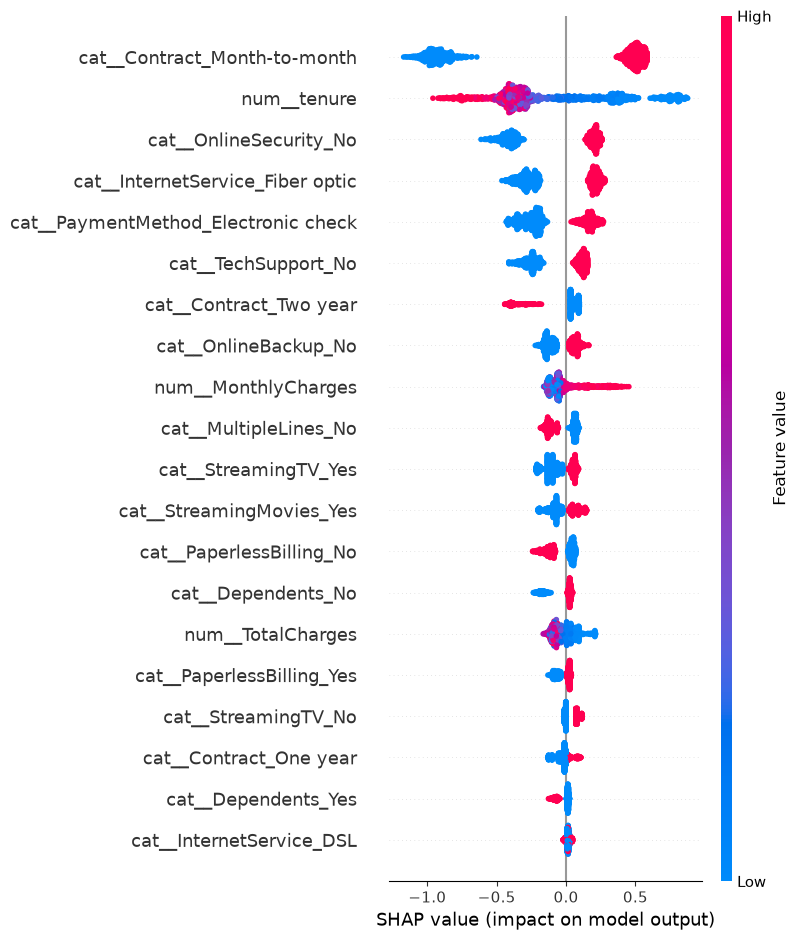
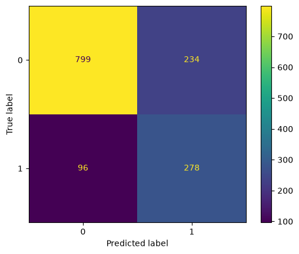
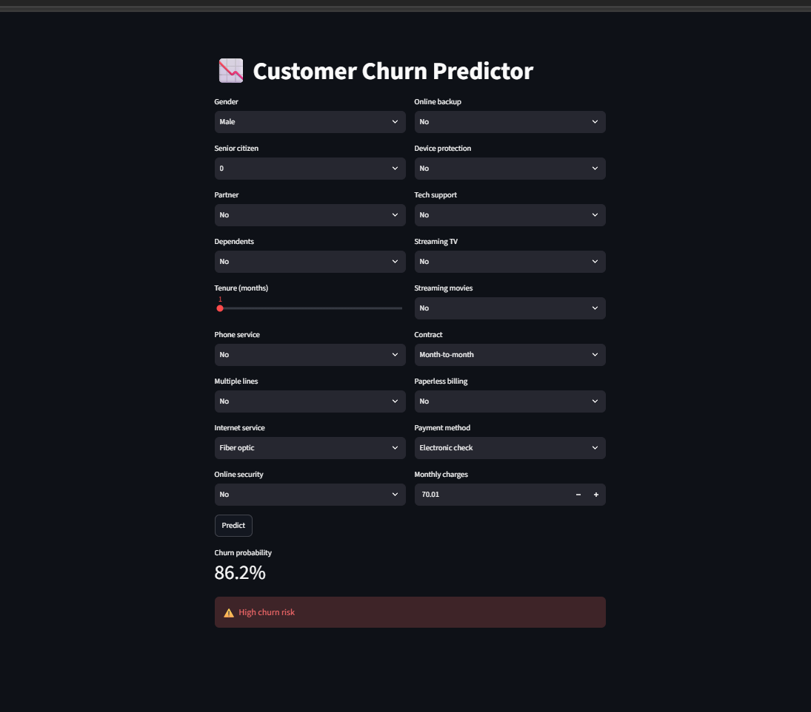
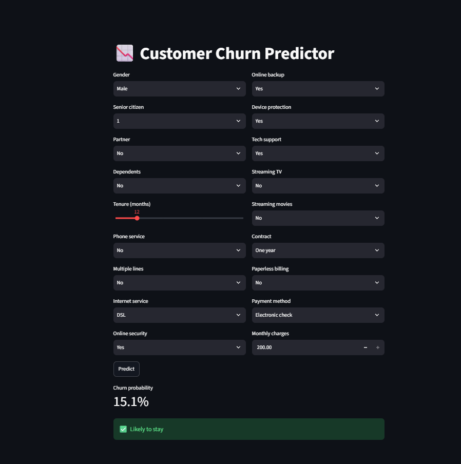

# Customer Churn Prediction

Predicts which telecom customers will leave, using the Kaggle Telco Churn dataset (7,032 customers, 26.5% churn).

## Results
| Model | CV F1 (churn class) |
|---|---|
| Logistic Regression | 0.632 |
| Random Forest | 0.593 |
| XGBoost (default) | 0.582 |
| XGBoost (Optuna-tuned) | 0.632 |

Final model on the held-out **test set**: F1 0.63, recall 0.74, precision 0.54.






## Method
- SMOTE inside the CV pipeline (no data leakage)
- Compared 3 models, tuned XGBoost with Optuna, searched the decision threshold
- SHAP explainability: month-to-month contracts and short tenure drive churn
- Streamlit app for live predictions

## Run
```
pip install -r requirements.txt
streamlit run app.py
```

## Limitations
Single dataset, no temporal validation. Precision is 0.54, so about 1 in 2 flagged customers would not actually churn.